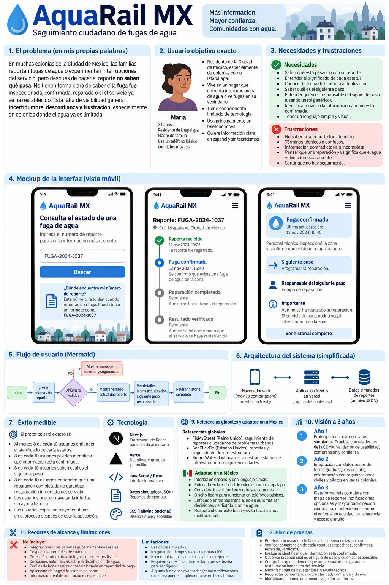
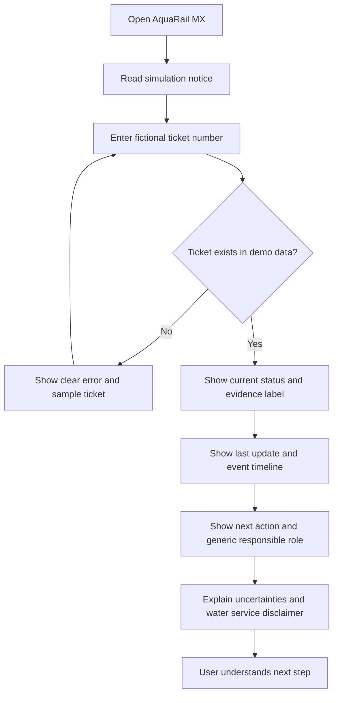
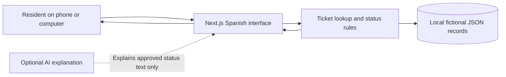
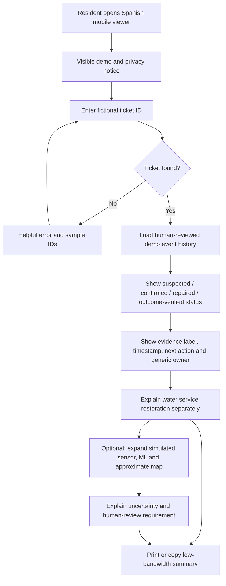
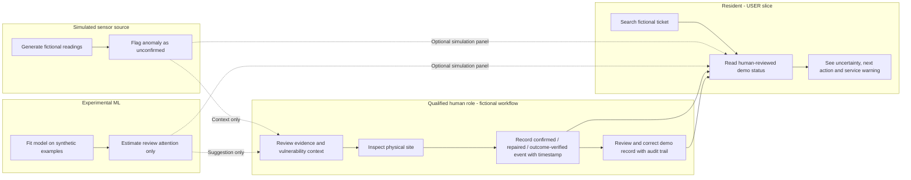
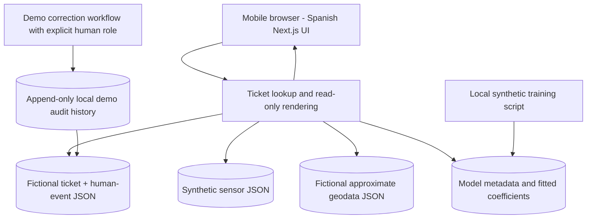

# AquaRail MX — Business Bending Week 11 PACKET

**Chapter:** Dreaming of Plenitude — When Scarcity Ends and What We Lose Anyway  
**Primary role:** USER  
**Team-selected vacuum:** LOSS VISIBILITY (3–2 vote)  
**Prototype:** Household-facing water leak status viewer, Mexico City  
**Status:** Planning only; no application code yet.
**Source of team decisions:** BLUEPRINT — WEEK 11 — TEAM 3 (provided by the team).

> **Revision: DRAGON STACK planning update — 2026-10-24.** This document retains the original USER and Blueprint scope. **Sections 6–8, 11, 15, 16, and 18 of the original packet are superseded or refined by the DRAGON STACK ADDENDUM below wherever they differ.** No implementation or validation is claimed. The image is an AI-generated conceptual mockup, not an application screenshot. The five SECURITY FLOOR requirements were supplied by the student and are recorded in section 24.

## 1. Problem in my own words
Families in Mexico City may report a neighborhood water leak but still have no clear way to understand what happens afterward. They do not know if someone inspected the problem, confirmed it, finished a repair, or checked the result. This uncertainty is especially frustrating when water service is unreliable. My USER contribution is to make the steps visible without claiming that a repair or water restoration has happened when it has not been verified.

## 2. Exact target user
A resident of an underserved Mexico City neighborhood, such as Iztapalapa, who uses a basic smartphone, has limited mobile data and technical knowledge, and wants to check a previously reported neighborhood leak. The resident should not need to create an account, pay, or provide sensitive household information.

## 3. User needs and frustrations
- Look up a fictional ticket using a simple number.
- Understand each stage in everyday Spanish.
- See the latest timestamp, the next step, and the generic role responsible.
- Know which details are confirmed versus unconfirmed.
- Understand that a completed repair does not guarantee household water service is restored.
- Avoid confusing technical words, hidden fees, or false promises.

## 4. Measurable success
Before the module closes, a mobile-friendly Next.js prototype lets a user enter at least three fictional ticket numbers and view distinct statuses, dated updates, uncertainty labels, next actions, and generic responsible roles. At least 8 out of 10 simulated persona test tasks should be completed without guidance; the persona should correctly identify whether a leak is physically confirmed, whether the repair is recorded as complete, and whether water service restoration has been verified. Record at least one confusion point, implement a fix, and retest it. These are goals, not achieved results.

## 5. Image-generated mockup

**Design note:** This is an AI-generated conceptual visual, not a screenshot of working software or a real municipal system. Its sample ticket and dates are fictional. The final prototype must explicitly label the simulation on every ticket detail screen and use consistent dates and status labels. The image includes broader planning panels; only the three phone views represent proposed screens.

## 6. User flow (Mermaid)

## 7. Simple architecture

The ticket data is static, structured, and explicitly simulated. AI is not required for version one. If later added, AI may paraphrase approved descriptions only; it cannot write status updates, assert inspections, or create confirmations.

## 8. Technology stack
| Layer | Choice | Reason |
| --- | --- | --- |
| Frontend | Next.js + React | Free, familiar, deployable |
| Styling | Plain CSS | Lightweight, accessible, no extra dependency |
| Data | Local JSON file | Transparent simulated tickets |
| Business logic | Deterministic TypeScript/JavaScript | Prevents AI from inventing statuses |
| Hosting | Vercel free tier, subject to plan limits | Simple prototype deployment |
| AI | Optional, not required in MVP | Plain-Spanish explanation only |
| Privacy | No login, tracking, or sensitive user profiles | Equity and trust |

## 9. Global benchmark and adaptation to Mexico
The team Blueprint names **TaKaDu, ASTERRA, FIDO, Singapore PUB, and Manila Water** as approaches to consider. Our small USER prototype does **not** replicate or integrate their operational systems. We borrow the broader principle of turning infrastructure signals into trackable actions, while focusing on the resident's ability to understand the repair timeline. These examples are team-selected reference points, not evidence of a successful Mexican pilot. Mexican adaptation means free Spanish-language access, basic mobile compatibility, low-bandwidth screens, generic roles, and visible uncertainty.

## 10. Three-year vision
- **Year 1:** Improve the free simulated viewer with community comprehension testing and accessible, printable status summaries.
- **Year 2:** Explore permission-based pilots with community organizations; import real data only with verified authorization, provenance, and correction processes.
- **Year 3:** If credible partnerships and funding exist, offer broader transparent reporting and optional low-bandwidth notifications without automated rationing, discriminatory profiling, or pay-to-prioritize service.

These are aspirations, not commitments or confirmed partnerships.

## 11. Scope cuts and limitations
**In scope:** Fictional ticket lookup, four repair stages, event timeline, timestamps, evidence labels, generic next-step owner, uncertainty messages, simple corrections to simulated records, Spanish interface, and mobile accessibility.

**Out of scope:** Real government connections, actual repair records, automatic dispatch, leak detection sensors, allocation decisions, household scoring, payment, logins, promises about repair times, and claims that repair completion restores water service.

The prototype cannot tell a resident whether an actual leak has been fixed. Even an outcome-verified demo record only describes the defined repair check; it does not prove that water has returned to each household.

## 12. Alignment with the six team Blueprint conditions
1. **Actionable closure:** Each fictional ticket shows its owner role, next action, current status, and a resolution record if available.
2. **Human authority:** Inspection, repair confirmation, and outcome verification are modeled as actions requiring qualified human review. The prototype never dispatches or diagnoses automatically.
3. **Incremental evidence:** The prototype can be compared with a simple spreadsheet or generic ticket list using user-comprehension and lookup-task metrics. It cannot demonstrate real water-loss reductions, cost savings, or actual repair times.
4. **Equity and anti-rationing:** Free and accessible viewing; no payment-based priority, punitive profiles, or automated rationing.
5. **Local feasibility:** Start with fictional structured records and a familiar low-cost phone interface; no sensors, live integrations, or always-on connectivity requirement.
6. **Truth and auditability:** Four distinct repair stages, timestamps, uncertainty labels, and a visible simulated correction history.

**Operational relationship:** José Luis (OPERATOR) owns the broader minimum ticket workflow from suspected leak through human inspection, repair, and outcome record. My USER slice displays understandable, read-only status information derived from that workflow. The other roles examine prioritization, economics, and adversarial risks. We do not claim to implement their separate workstreams.

## 13. Truth, auditability, and correction rules
- Every ticket visibly says **DATOS SIMULADOS — NO ES INFORMACIÓN OFICIAL**.
- Every event stores `status`, `evidenceLevel`, `updatedAt`, `nextAction`, `responsibleRole`, and a short `explanation`.
- Evidence levels are **CONFIRMADO EN SIMULACIÓN**, **REPORTADO / NO VERIFICADO**, and **SIN INFORMACIÓN**. These refer only to the demo dataset.
- A suspected leak cannot silently become physically confirmed; a recorded repair cannot silently become an outcome-verified repair.
- Preserve an event history when changing demo records. Include a clearly labeled demo correction control, or a local reset/edit simulation in the next build stage; do not imply residents can edit official records.
- Keep water service restoration as a separate field (`unknown`, `reported`, or `verified in simulation`), never inferred from repair status.

## 14. Equity and anti-rationing
Free access, no pay-to-prioritize, no household demographic profiles, no automated water allocation, no account required. Use readable text plus icons rather than color alone, keyboard-accessible controls, plain Spanish, and a small mobile payload. Offer a printable or copyable summary where feasible, so residents do not need continuous connectivity.

## 15. Persona test plan
**Simulated persona:** An Iztapalapa resident with limited technical knowledge, a basic smartphone, and concern about a neighborhood leak.

**Tasks:**
1. Enter a sample fictional ticket without assistance.
2. Explain the difference between a possible and physically confirmed leak.
3. Identify the last update and which information remains unverified.
4. State the next action and generic role responsible.
5. Explain why a completed repair does not prove water has returned.
6. Find and understand the simulation notice.
7. Navigate the page using only visible instructions.

**Record:** Exact user statements, successful/failed tasks, confusion, severity, a proposed fix, the implemented change, and the retest outcome. Do not claim test success until testing occurs.

## 16. Suggested fictional tickets for build stage
| Ticket | Repair status | Water service | Evidence | Next action |
| --- | --- | --- | --- | --- |
| FUGA-DEMO-101 | Possible leak | Unknown | Reported, not verified | Review report |
| FUGA-DEMO-102 | Physically confirmed | Unknown | Confirmed in simulation | Schedule repair |
| FUGA-DEMO-103 | Repair completed | Unknown | Repair recorded in simulation | Verify outcome |
| FUGA-DEMO-104 | Outcome verified | Unknown | Repair outcome checked in simulation | Monitor and update if needed |

Each ticket will use a fictional timestamp and generic responsible role. None represents a real resident, repair, agency, or government ticket.

## 17. USER-role design decision
I originally preferred Household Water Tools, but our team selected LOSS VISIBILITY by a 3–2 vote. I support the team Blueprint and focus my contribution on what a resident needs to understand: what is known, what is not known, who acts next, and why a repair status is different from restored water service. AquaRail MX should reduce confusion, not create false certainty.

## 18. Demo-ready acceptance checklist (not yet completed)
- [ ] Search one of four fictional ticket numbers and handle an invalid number without confusion.
- [ ] Show status, last update, evidence label, generic owner, next action, and timeline.
- [ ] Distinguish **repair work recorded** from **repair outcome verified**.
- [ ] Always display **repair status ≠ household water service restored**.
- [ ] Keep corrections restricted to a clearly marked simulated record, with before/after history.
- [ ] Test a simulated Iztapalapa resident, document confusion, implement one improvement, and retest.
- [ ] Deploy the completed Next.js prototype on Vercel and verify the public link.

**Honest demo sentence:** “This is a fictional ticket viewer, not an official Mexico City repair tracking service. It demonstrates how a resident could understand what is known and what is still unconfirmed.”

---
# DRAGON STACK ADDENDUM — AUTHORITATIVE BUILD SPECIFICATION

## 19. Three required technologies and evidence boundaries

| Capability | Input | Processing | Output | Truth / authority boundary |
|---|---|---|---|---|
| **IoT/sensing (simulated)** | Fictional timestamped pressure (kPa) and flow (L/min) measurements tied to fictional ticket IDs | Deterministic sample readings from bundled JSON; label `SENSOR SIMULADO` | Sensor trend or anomaly hint; never a physical inspection | An anomalous reading is **not** proof of a leak, repair, or restored service |
| **Machine learning (real, executable; synthetic)** | Synthetic, non-personal operational features such as simulated pressure drop, flow deviation, reported interruption duration, and approximate infrastructure-related service vulnerability at neighborhood level | Fit a small deterministic model using a free local JavaScript ML library (e.g., `ml-regression-multivariate-linear`) or a documented tiny linear regression implementation with real training and inference; train on synthetic cases and persist model coefficients/metadata | `Estimación experimental para revisión humana` on a 0–100 illustrative scale; show model version, synthetic training source, uncertainty warning | No dispatch, priority assignment, excavation, rationing, repair authorization, or change to ticket status; qualified human makes decisions |
| **Geodata (fictional)** | Approximate, invented neighborhood centroid coordinates; never a home address | Display textual neighborhood and optionally an offline SVG overview or static map without external API | General geographic context only | Coordinates are demonstrative, not precise incident locations or proof of a municipal event |

**Separation rule:** `sensorReading` and `mlReviewEstimate` live in clearly marked experimental panels, separate from the `humanEventHistory` used to render the resident-facing status. The public viewer's authoritative *within-demo* status comes only from an explicit fictional human-reviewed event with reviewer role, timestamp, and provenance. Never derive confirmed, repaired, or verified statuses from a sensor or ML score. Do not display the ML score as a queue rank or resident entitlement. ML may be placed in a collapsible **Cómo funciona la simulación** panel so USER comprehension remains primary.

**Synthetic ML details:** Generate at least 40 fixed-seed synthetic training examples and 10 held-out synthetic examples. Fit a numeric regression model to a **synthetic training label** (`reviewAttentionExample`, 0–100). The model is executable at build time or locally via a repeatable npm script and used at inference time on synthetic ticket features. Record seed, features, fit command, train/test counts, MAE on held-out *synthetic* data, and model version. MAE demonstrates only consistency with invented labels, not real-world validity. A constant/hard-coded lookup table alone does not meet the ML requirement. No individual demographics, exact addresses, payment data, or household identifiers as features. Community vulnerability, where included, is a transparent neighborhood-level illustrative service indicator for human consideration, never a profiling variable or an automatic rank. Prefer keeping that indicator **outside** the ML feature vector and showing it separately to human reviewers, preventing an opaque model from embedding allocation policy. No training or inference API calls.

## 20. Updated Mermaid user flowchart

## 21. Updated Mermaid swimlane: evidence vs authority

## 22. Architecture and free stack

| Layer | Proposed free technology | Reason / restriction |
|---|---|---|
| UI | Next.js, React, TypeScript | Mobile-friendly Spanish status viewer |
| Styling | Plain CSS | No paid UI dependencies, readable, keyboard focus |
| Ticket, events, sensing, geodata | Bundled JSON + TypeScript schema checks | Deterministic fictional data; no real personal information |
| ML | Local Node script with a free JS regression package or implemented linear regression | Actual fitting on fixed-seed synthetic data; versioned artifact; no paid API |
| Map | Offline SVG schematic or text location; optional free client library only if needed | No map key or real addresses; low bandwidth |
| Correction/audit demo | In-memory or browser-local-only demonstration with before/after log; reset control | No real authority or durable official edits; browser storage only if disclosed |
| Testing | Node built-in test runner; Playwright if available at no cost | Mechanical tests and screenshot evidence |
| Hosting | GitHub + Vercel Hobby, subject to free-tier eligibility and limits | Two planned deployments; no secrets required |

**Data contract:** Each ticket has `ticketId`, `approxNeighborhood`, `fictionalCoordinates`, `status`, `waterServiceState`, `updatedAt`, `nextAction`, `responsibleRole`, `humanEventHistory[]`, `sensorReadings[]`, `mlEstimate` and `correctionHistory[]`. `humanEventHistory[]` requires `eventType`, `timestamp`, `reviewerRole`, `evidenceLabel`, `sourceType='FICTIONAL_HUMAN_RECORD'`. For `suspected`, label as unverified report and do not fabricate a physical confirmation. Any changes to demo records append before/after values, simulated editor role and time; do not allow public viewer edits to imply municipal authority. Consider corrections as a separate clearly labeled sandbox interaction.

## 23. Exact acceptance criteria (all pending)

| ID | Feature | Objective acceptance test |
|---|---|---|
| A1 | Ticket search | All four sample IDs resolve to their corresponding records; blank and invalid IDs show helpful Spanish errors without a crash |
| A2 | Four statuses | `101` suspected, `102` physically confirmed, `103` repaired, `104` outcome-verified; labels and timelines match their human-event records |
| A3 | Evidence truth | Every ticket says `DATOS SIMULADOS — NO ES INFORMACIÓN OFICIAL`; all events show time and evidence level; sensor/ML alone never upgrades status |
| A4 | Service warning | Every ticket displays `Reparación no significa que el servicio de agua ya se restableció`; service state shown separately, unknown by default |
| A5 | Next action | Every ticket shows latest update, next action, and generic responsible role; no invented agency assignments |
| A6 | IoT | Each ticket can show at least three dated fictional pressure/flow readings and `SENSOR SIMULADO`; anomaly text says not physically confirmed |
| A7 | Executable ML | Reproducible fit on >=40 fixed-seed synthetic cases, >=10 held-out synthetic cases; test verifies nonempty fitted coefficients, inference returns finite 0–100 value, and evaluation writes synthetic MAE; no municipal predictive claim |
| A8 | Human authority | Automated tests verify ML/sensor data cannot alter human-event status or trigger dispatch/priority/rationing; no such actions exposed |
| A9 | Geodata | Four tickets display only invented approximate neighborhood locations; no household address, geolocation permission, or map API key |
| A10 | Correction audit | Sandbox correction produces visible before/after audit entry and can be reset; viewer cannot masquerade as an official edit |
| A11 | Accessibility | Mobile viewport 360px wide without horizontal overflow; keyboard-only ticket lookup; visible focus; icon+text labels; basic readable contrast check |
| A12 | Security | Five official SECURITY FLOOR checks in section 24 are assessed (conditional items 2–3 N/A for this no-personal-data prototype); no external secrets or personally identifying data in repo |
| A13 | Mechanical bug | Record a reproducible failing case, a real code fix, passing regression test, and before/after evidence; **not completed yet** |
| A14 | Persona | Capture real prototype screenshots, simulated Iztapalapa persona utterances, confusion log, implemented UI fix and retest; **not completed yet** |
| A15 | Deployments | Two distinct Vercel deployments planned and, when executed, URLs and smoke-test outcomes recorded; **not completed yet** |

## 24. SECURITY FLOOR — official five requirements (user-provided)

1. **No exposed secrets.** No keys, tokens or credentials in source control, client code, screenshots, logs or sample files. `.env*` is ignored except an optional safe `.env.example`. Phase 1 uses no secrets.
2. **Supabase Google Auth if storing personal data.** This prototype does **not** collect or store personal data and therefore has no authentication, Supabase integration, or personal-data backend. If scope changes to personal-data storage, stop and add Supabase Google Auth before implementation.
3. **Row Level Security for personal-data tables.** No database or personal-data tables exist in this prototype. If future scope introduces such tables, enable and test RLS before collecting data.
4. **Input validation.** Ticket IDs are trimmed, length-bounded and allowlisted; malformed, blank and unknown inputs fail safely with Spanish messages. No user input is interpreted as HTML or used in queries.
5. **Fictional demo data only.** All tickets, timestamps, sensor readings, model training cases and neighborhood coordinates are fabricated; never insert real resident records, exact addresses or municipal claims.

**Applicability:** Items 2–3 are conditional and not applicable in Phase 1 because no personal data or database is used. All other checks are required. These are the professor's five requirements as supplied by the student.

## 25. Five-commit development plan — proposed, none executed

| Commit | Intended scope | Exit evidence |
|---|---|---|
| 1 `docs: align packet and blueprint` | Updated PACKET, mockup, DECISIONS, build prompt, repo hygiene | Documentation files present and reviewed |
| 2 `feat: add synthetic evidence and trained ml` | Fictional tickets, sensing, geodata, fixed-seed training script, model metadata and tests | Reproducible model-fit output and separation tests |
| 3 `feat: build spanish resident status viewer` | Ticket search, four statuses, timeline, next step, service warning, optional simulation details | UI screenshots and mechanical lookup tests |
| 4 `test: fix verified bug and improve accessibility` | Reproduce at least one genuine bug, fix it, add regression test; keyboard/mobile improvements | Bug log, failing-then-passing evidence, screenshots |
| 5 `docs: persona retest and session close` | Synthetic persona confusion log, implemented improvement, retest, DECISIONS update, final demo notes | Recorded evidence and final push confirmation |

**Note:** Persona-discovered improvement may require code changes in commit 5; do not falsely label commit 4's fix as the persona fix unless that is what actually happened. Commit plan may be adjusted to maintain five meaningful commits. No commit is yet made.

## 26. Two Vercel deployments — planned only

- **Deployment 1 (after commit 3):** First functioning ticket viewer with clearly labeled synthetic IoT/ML/geodata; capture deployment URL, build result, and mobile smoke-test notes. Do not call it production-ready.
- **Deployment 2 (after commits 4–5):** Tested version after genuine bug fix and persona-driven improvement; capture second deployment URL and re-run smoke tests. Compare changes and retain both URLs if Vercel makes them accessible.

Never invent a deployed URL, test outcome, or Vercel success message. Vercel Hobby limits and project eligibility should be checked at deployment time.

## 27. Mechanical test and bug-fix protocol — future work

Run TypeScript type checking, linting, production build, schema checks, unit tests for status/evidence boundaries, malformed ticket inputs, ML fitting/inference, and basic mobile/keyboard browser tests. Intentionally **search for a real bug** during testing, log `steps to reproduce → observed result → expected result → failing test → code change → passing regression test`, and attach screenshots or terminal evidence. Do not manufacture a bug or assert one has been found. If no genuine bug appears, expand edge-case testing until one is discovered; do not fake completion.

## 28. Synthetic USER persona test — future work

**Persona:** A fictional resident of Iztapalapa using a low-cost smartphone, limited mobile data, and everyday Spanish. They want to know if a neighborhood leak was *actually* repaired. The persona is a simulation, **not** evidence from a real participant.

**Screenshots to capture after UI exists:** ticket entry; suspected vs physically confirmed; repaired but not verified; outcome-verified with service still unknown; optional IoT/ML/map explanation; mobile error state; revised screen after fix.

**Tasks and questions:** Find `FUGA-DEMO-103`; say whether repair is done or independently verified; find last update and next action; explain who acts next; identify whether sensor reading or ML score is confirmed; explain whether water service is restored; complete on a 360px screen without help. Record verbatim synthetic reactions, confusion category/severity, change requested, exact implementation change, retest response and limitations. At least one improvement must be implemented and retested; do not prewrite feedback or success claims.

**Comprehension goal:** >=8 of 10 predefined tasks successful in a documented synthetic walkthrough; separately report that synthetic testing does not validate actual community comprehension. Do not imply human-subject research.

## 29. Session Close — required after each working session

1. Update `docs/DECISIONS.md` with date, decision, reason, tradeoff, and what is still unverified.
2. Record **one concrete next action** and who will do it in `docs/NEXT_ACTION.md` or the decisions log.
3. Check working tree and run relevant tests/build (record failures, do not hide them).
4. Stage only intended files; commit with a meaningful message; push to GitHub; verify remote state.
5. Save links/evidence (commit hash, test output, screenshots, deployment URLs when they exist). If push fails, log it and do not claim completion.

## 30. Global benchmark, Mexican adaptation, three-year vision and scope cuts (updated)

**Global reference points chosen by team:** TaKaDu, ASTERRA, FIDO, Singapore PUB, Manila Water. They are benchmarks for sensing-to-action workflows, not integrations, independently verified performance claims, or evidence of a Mexican pilot. AquaRail MX's differentiator is a resident-facing evidence timeline with uncertainty labels. Adapt to Mexico with plain Spanish, free access, generic operational roles, low-bandwidth/offline-friendly print/copy summary, approximate fictional neighborhoods, and no mandatory app download.

**Three years (aspirational):** Year 1 — refine fictional viewer and test readability with residents if ethically and practically possible. Year 2 — explore opt-in, permission-based community/municipal data pilots with correction and provenance controls. Year 3 — if partnerships, budgets and verified evidence permit, expand transparent status coverage and low-bandwidth alerts, never automated rationing or pay-to-prioritize. No partnerships are claimed.

**Scope cuts:** No physical sensors, actual IoT streams, real leak detection, real municipal integrations, actual repair dispatch, automated excavation, household risk scoring, real addresses, resident accounts, SMS gateways, paid maps, LLM APIs, guaranteed repair time, or promises of water restoration. The ML score is not a live operations model and cannot establish real water-loss reduction. Human-event records are fictional demonstrations, not official records.

## 31. Demonstration explanation (USER role)

> “I designed the part that a resident actually sees. A ticket shows four different repair stages, timestamps, evidence labels, the next step, and who is responsible. We added simulated sensor readings, a real model fitted on synthetic data, and fictional approximate geodata to meet the DRAGON STACK. Those experimental signals never become repair facts: a human-reviewed record is required. Even a repaired leak does not mean water has returned to a household. Everything is fictional and clearly labeled.”

**Build gate:** Do not write application code until the user confirms this Packet and implementation prompt. No successful test, commit, persona session, or deployment is asserted in this document.
