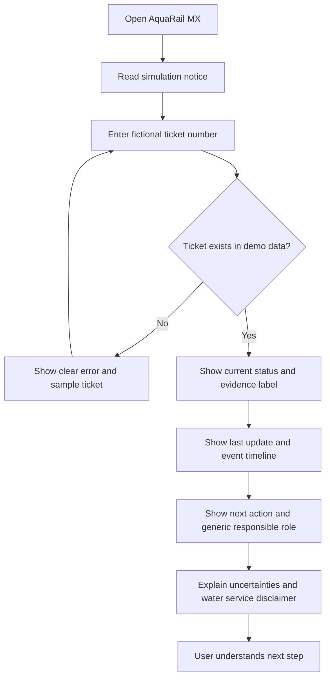
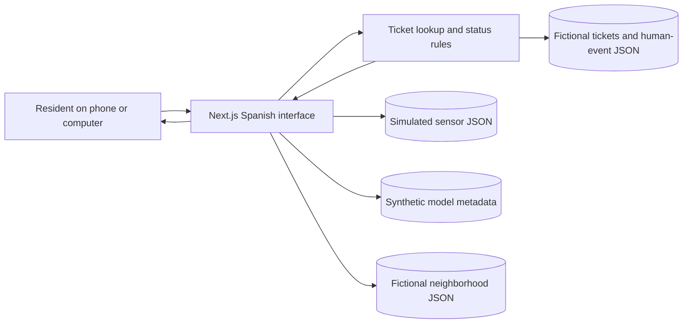
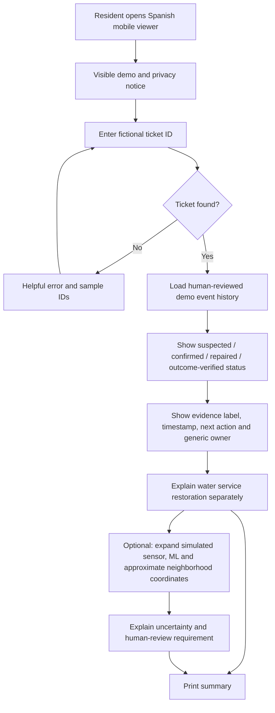
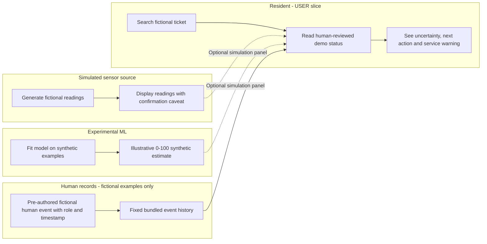
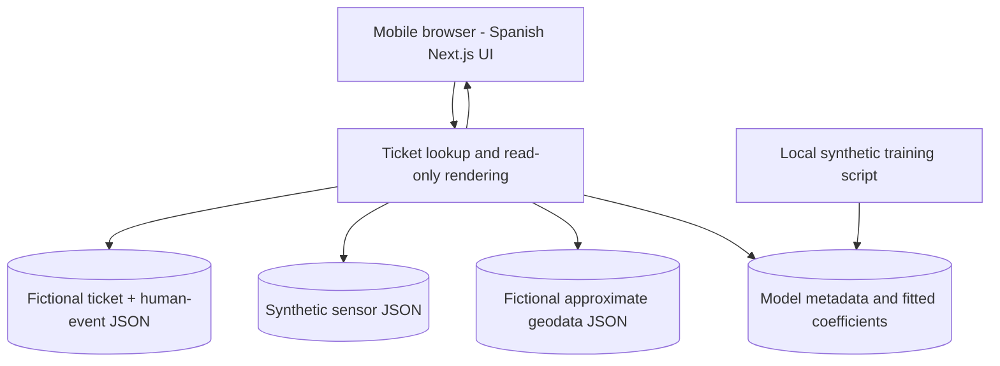

# AquaRail MX — Business Bending Week 11 PACKET

**Chapter:** Dreaming of Plenitude — When Scarcity Ends and What We Lose Anyway  
**Primary role:** USER  
**Team-selected vacuum:** LOSS VISIBILITY (3–2 vote)  
**Prototype:** Household-facing water leak status viewer, Mexico City  
**Status:** Week 11 prototype implemented, tested locally, and deployed. This remains a fictional educational demo, not an official municipal service.  
**Deployed URL:** [https://aquarail-mx.vercel.app](https://aquarail-mx.vercel.app)  
**GitHub repository:** [https://github.com/monyzaragozaa-cmd/aquarail-mx](https://github.com/monyzaragozaa-cmd/aquarail-mx)  
**Source of team decisions:** BLUEPRINT — WEEK 11 — TEAM 3 (provided by the team).

> **Week 11 implementation update — 2026-10-24.** This packet retains the original USER role and LOSS VISIBILITY scope, refined by the DRAGON STACK implementation details below. Implementation, local tests, build, synthetic role-play, and a live URL smoke check are recorded in this revision. The deployed page rendered and ticket lookup worked, but the browser reported React hydration error `#418` on load; investigate this before treating the live build as clean. The image remains an AI-generated conceptual mockup, not an application screenshot. The five SECURITY FLOOR requirements were supplied by the student and are preserved in section 24.

## 1. Problem in my own words
Families in Mexico City may report a neighborhood water leak but still have no clear way to understand what happens afterward. They do not know if someone inspected the problem, confirmed it, finished a repair, or checked the result. This uncertainty is especially frustrating when water service is unreliable. My USER contribution is to make the steps visible without claiming that a repair or water restoration has happened when it has not been verified.

## 2. Exact target user
A resident of an underserved Mexico City neighborhood, such as Iztapalapa, who uses a basic smartphone, has limited mobile data and technical knowledge, and wants to check a previously reported neighborhood leak. The resident should not need to create an account, pay, or provide sensitive household information.

## 3. User needs and frustrations
- Look up a fictional ticket using a simple number.
- Understand each stage in everyday Spanish.
- See the latest timestamp, the next step, and the generic role responsible.
- Know which details are confirmed versus unconfirmed.
- Understand that a completed repair does not guarantee household water service is restored.
- Avoid confusing technical words, hidden fees, or false promises.

## 4. Measurable success
**Implemented:** The mobile-friendly Next.js prototype accepts all four fictional ticket IDs and displays distinct statuses, dated human-event histories, uncertainty labels, next actions, generic responsible roles, and a separate unknown household-service state. Input handling, status boundaries, IoT/ML separation, mobile overflow, keyboard navigation, and the repair guidance were checked; see `tests/phase1.test.mjs` and `docs/BUG_LOG.md`.

**Not measured:** The original target of at least 8 out of 10 persona tasks is not a result. Laura's walkthrough in `docs/PERSONA_TEST.md` is explicitly synthetic; no real participants were tested, and ticket-specific before/after screenshots are not saved in the repository.

## 5. Image-generated mockup

**Design note:** This is an AI-generated conceptual visual, not a screenshot of working software or a real municipal system. Its sample ticket and dates are fictional. The implemented viewer labels the simulation and fictional records, uses the four distinct statuses, and shows dated human-event history. The image includes broader planning panels; only the three phone views represent proposed screens.

## 6. User flow (Mermaid)

## 7. Simple architecture

The ticket, sensor, model, and neighborhood data are bundled JSON. The implemented prototype uses deterministic local logic and no AI service, backend API, or database. The UI is read-only: it has no correction workflow or persistent record editing.

## 8. Technology stack
| Layer | Choice | Reason |
| --- | --- | --- |
| Frontend | Next.js + React | Free, familiar, deployable |
| Styling | Plain CSS | Lightweight, accessible, no extra dependency |
| Data | Bundled local JSON | Four fictional tickets, simulated readings, model metadata, approximate geodata |
| Business logic | Deterministic JavaScript | Input validation and human-event status verification; no AI-generated status |
| ML | Local synthetic linear regression | Fixed-seed fitted artifact and estimate; illustrative only |
| Hosting | Vercel | Deployed at the URL in the packet header |
| Repository | GitHub | Public repository linked in the packet header |
| Privacy | No login, database, personal-data storage, tracking, or sensitive user profiles | No secrets required by this prototype |

## 9. Global benchmark and adaptation to Mexico
The team Blueprint names **TaKaDu, ASTERRA, FIDO, Singapore PUB, and Manila Water** as approaches to consider. Our small USER prototype does **not** replicate or integrate their operational systems. We borrow the broader principle of turning infrastructure signals into trackable actions, while focusing on the resident's ability to understand the repair timeline. These examples are team-selected reference points, not evidence of a successful Mexican pilot. Mexican adaptation means free Spanish-language access, basic mobile compatibility, low-bandwidth screens, generic roles, and visible uncertainty.

## 10. Three-year vision
- **Year 1:** Improve the free simulated viewer with community comprehension testing and accessible, printable status summaries.
- **Year 2:** Explore permission-based pilots with community organizations; import real data only with verified authorization, provenance, and correction processes.
- **Year 3:** If credible partnerships and funding exist, offer broader transparent reporting and optional low-bandwidth notifications without automated rationing, discriminatory profiling, or pay-to-prioritize service.

These are aspirations, not commitments or confirmed partnerships.

## 11. Scope cuts and limitations
**Implemented:** Fictional ticket lookup, four repair stages, human-event timeline, timestamps, evidence labels, generic next-step owner, uncertainty messages, Spanish interface, simulated IoT readings, synthetic ML estimate, approximate fictional neighborhood coordinates, expandable technical details, and a print action. Responsive layout and keyboard interactions were checked locally.

**Not implemented / out of scope:** Real government connections, actual repair records, real IoT streams or leak detection, public corrections or edits, database or account features, automatic dispatch, allocation decisions, household scoring, payment, promises about repair times, and claims that repair completion restores water service.

The prototype cannot tell a resident whether an actual leak has been fixed. Even an outcome-verified demo record only describes the defined repair check; it does not prove that water has returned to each household.

## 12. Alignment with the six team Blueprint conditions
1. **Actionable closure:** Each fictional ticket shows its owner role, next action, current status, and a resolution record if available.
2. **Human authority:** Inspection, repair confirmation, and outcome verification are represented only by pre-authored fictional human records. The prototype never performs or verifies a real inspection and never dispatches or diagnoses automatically.
3. **Incremental evidence:** The prototype can be compared with a simple spreadsheet or generic ticket list using user-comprehension and lookup-task metrics. It cannot demonstrate real water-loss reductions, cost savings, or actual repair times.
4. **Equity and anti-rationing:** Free and accessible viewing; no payment-based priority, punitive profiles, or automated rationing.
5. **Local feasibility:** The prototype uses fictional structured records and a familiar phone interface; it has no live sensor integration, external data integration, or always-on connection to a municipal system.
6. **Truth and auditability:** Four distinct fictional repair stages, timestamps, uncertainty labels, and fixed human-event histories. No simulated correction workflow is implemented.

**Operational relationship:** José Luis (OPERATOR) owns the broader minimum ticket workflow from suspected leak through human inspection, repair, and outcome record. My USER slice displays understandable, read-only status information derived from that workflow. The other roles examine prioritization, economics, and adversarial risks. We do not claim to implement their separate workstreams.

## 13. Truth and evidence boundaries
- Every ticket visibly says **DATOS SIMULADOS — NO ES INFORMACIÓN OFICIAL**.
- Ticket records contain `status`, `waterServiceState`, `updatedAt`, `nextAction`, `responsibleRole`, `humanEventHistory`, and a fictional marker. Human events contain event type, timestamp, reviewer role, evidence label, and fictional source type.
- Evidence labels in the implemented data include **REPORTADO / SIN CONFIRMAR** and **REGISTRO HUMANO FICTICIO · NO OFICIAL**. They describe only the fictional demo records.
- A suspected leak cannot silently become physically confirmed; a recorded repair cannot silently become an outcome-verified repair.
- There is no correction control, record editing, or audit-trail workflow. The visible history is a fixed fictional event history, not a correction ledger.
- Keep water service restoration in a separate field; all four implemented tickets currently set it to `unknown`, never inferred from repair status.

## 14. Equity and anti-rationing
Free access, no pay-to-prioritize, no household demographic profiles, no automated water allocation, and no account required. The interface uses Spanish labels, visible focus styles, native form controls, and responsive layout; keyboard operation and 320 px/390 px horizontal overflow were checked. A print-summary action is implemented. No formal contrast audit, offline mode, or low-bandwidth measurement is claimed.

## 15. Synthetic persona walkthrough
**Synthetic persona:** Laura, 48, a fictional Iztapalapa resident with limited technical knowledge. Her scenario and simulated first-person responses are recorded in `docs/PERSONA_TEST.md`.

The walkthrough uses the current `FUGA-DEMO-103` interface and simulates how a resident might interpret “Reparación registrada · sin verificar,” the generic verification role, the separate unknown household-service state, and the recommendation to consult official channels if water is still unavailable. It is **not** a real participant session, measured task test, or evidence that actual residents understand the interface.

The implemented USER-facing improvement adds “¿Qué significa para ti?” and “¿Qué puedes hacer?” under the next step for `repaired`. No actual before/after ticket screenshots are saved in the repository. The Iztapalapa persona / Tláhuac ticket mismatch is documented as a limitation, not participant feedback.

## 16. Implemented fictional tickets
| Ticket | Repair status | Water service | Evidence | Next action |
| --- | --- | --- | --- | --- |
| FUGA-DEMO-101 | Possible leak / `suspected` | Unknown | Fictional report, no physical confirmation | Solicitar revisión física |
| FUGA-DEMO-102 | Physically confirmed / `confirmed` | Unknown | Fictional human inspection record | Programar atención según revisión humana |
| FUGA-DEMO-103 | Repair recorded, outcome unverified / `repaired` | Unknown | Fictional human repair record | Verificar resultado de la reparación |
| FUGA-DEMO-104 | Outcome verified / `verified` | Unknown | Fictional human outcome-verification record | Continuar seguimiento del servicio por canales oficiales |

Each ticket uses fictional timestamps and a generic responsible role. None represents a real resident, repair, agency, or government ticket.

## 17. USER-role design decision
I originally preferred Household Water Tools, but our team selected LOSS VISIBILITY by a 3–2 vote. I support the team Blueprint and focus my contribution on what a resident needs to understand: what is known, what is not known, who acts next, and why a repair status is different from restored water service. AquaRail MX should reduce confusion, not create false certainty.

## 18. Prototype acceptance status
- [x] Search all four fictional ticket numbers; blank, malformed, and unknown IDs return Spanish errors.
- [x] Show status, last update, fictional evidence label, generic owner, next action, and human-event timeline.
- [x] Distinguish **repair work recorded** from **repair outcome verified**.
- [x] Keep household water service separately unknown and never promise restoration.
- [x] Keep simulated IoT and synthetic ML separate from fictional human-event status.
- [x] Add resident-facing guidance for the `repaired` status and visually verify it for `FUGA-DEMO-103`.
- [x] Run mobile-width and keyboard interaction checks; see `docs/BUG_LOG.md`.
- [x] Deploy the prototype and verify the URL responds and ticket lookup works.
- [ ] Resolve the live-page React hydration error `#418` observed during browser smoke check.
- [ ] Conduct a real usability session and capture ticket-specific before/after screenshots; the current persona walkthrough is synthetic only.
- [ ] Implement a simulated correction/audit workflow; it is not part of the current prototype.

**Honest demo sentence:** “This is a fictional ticket viewer, not an official Mexico City repair tracking service. It demonstrates how a resident could understand what is known and what is still unconfirmed.”

---
# DRAGON STACK ADDENDUM — IMPLEMENTATION MAPPING

## 19. DRAGON STACK implementation and evidence boundaries

This section records the implemented Week 11 stack and its limits. It does not imply that every proposed capability in the original build specification was implemented.

| Capability | Input | Processing | Output | Truth / authority boundary |
|---|---|---|---|---|
| **IoT/sensing (simulated)** | Fictional timestamps, pressure readings in bar, and flow in L/min linked to fictional ticket IDs | Three deterministic example readings per ticket from bundled JSON; labeled `SENSOR SIMULADO` | Readings shown in the expandable details panel; no physical inspection is performed | A reading or anomaly is **not** proof of a leak, repair, or restored service |
| **Machine learning (executable; synthetic)** | Synthetic features `pressureDrop`, `flowAnomaly`, and `reportAge`; no personal data | Local Node training script fits a linear model from fixed-seed synthetic examples and stores coefficients/metadata | Illustrative 0–100 score labeled for human review; not an operational score. Current UI uses the same illustrative feature values for the displayed estimate across tickets. | No dispatch, priority assignment, excavation, rationing, repair authorization, or change to ticket status |
| **Geodata (fictional)** | Invented approximate neighborhood coordinates; never a home address | Display neighborhood name and coordinates as text | General geographic context only; no map is implemented | Coordinates are demonstrative, not precise incident locations or proof of a municipal event |

**Separation rule:** Sensor readings and the illustrative ML score appear in the collapsible technical-details panel, separately labeled from the human event history used to render resident-facing status. Ticket verification requires the corresponding fictional human event, reviewer role, timestamp, and source label. Sensor and ML values cannot derive confirmed, repaired, or verified statuses. The ML score is not a queue rank or resident entitlement.

**Synthetic ML details:** The checked-in model metadata records version `synthetic-ols-v1`, seed `11024`, 60 synthetic training cases, 20 held-out synthetic cases, three features, coefficients, and held-out synthetic MAE `2.331`. `npm run train` runs the local deterministic fit. The MAE only measures fit against invented labels and does not establish real-world validity. No training or inference API calls are made. The displayed estimate is not used to rank tickets or change their status.

## 20. Updated Mermaid user flowchart

## 21. Updated Mermaid swimlane: evidence vs authority

## 22. Architecture and free stack

| Layer | Implemented technology | Reason / restriction |
|---|---|---|
| UI | Next.js, React, TypeScript | Mobile-friendly Spanish status viewer |
| Styling | Plain CSS | No paid UI dependencies, readable, keyboard focus |
| Ticket, events, sensing, geodata | Bundled JSON | Deterministic fictional data; no real personal information |
| ML | Local Node training script and implemented linear regression | Fixed-seed synthetic fitting and checked-in metadata; no paid API |
| Map | Text neighborhood and approximate coordinates | No map or map API key; no real addresses |
| Record correction/audit | Not implemented | Viewer is read-only; bundled event histories are fixed examples |
| Testing | Node built-in test runner, TypeScript typecheck, Next.js production build, browser exploratory checks | Results and limitations are recorded in project docs |
| Hosting | Vercel deployment; GitHub repository | Live URL and repository are linked in the packet header |

**Data contract:** Ticket records include `ticketId`, `neighborhood`, `status`, `waterServiceState`, `updatedAt`, `nextAction`, `responsibleRole`, `humanEventHistory[]`, and `fictional`. Human events include `eventType`, `description`, `timestamp`, `reviewerRole`, `evidenceLabel`, and `sourceType='FICTIONAL_HUMAN_RECORD'`. Sensor readings are stored separately with `sourceType='SIMULATED_SENSOR'`; neighborhood coordinates and model metadata are in separate JSON files. There is no per-ticket `mlEstimate` or `correctionHistory` field and no editable correction workflow.

## 23. Acceptance criteria and verification status

| ID | Feature | Evidence and status |
|---|---|---|
| A1 | Ticket search | **Verified locally:** all four IDs, blank, malformed, unknown, lowercase, and extra-space cases were exercised; tests cover malformed inputs. |
| A2 | Four statuses | **Verified locally and in UI:** all four status labels and their fixed human-event histories were displayed. |
| A3 | Evidence truth | **Verified:** simulation notices and fictional human-event labels are present; tests confirm sensor/ML cannot synthesize human verification. |
| A4 | Service warning | **Verified:** all records retain `waterServiceState: unknown`; the UI says repair does not mean service is restored. |
| A5 | Next action | **Verified:** each ticket displays its configured timestamp, next action, and generic role. |
| A6 | IoT | **Verified:** three fictional pressure/flow readings per ticket; the source and limitation are labeled. |
| A7 | Executable ML | **Verified:** local training script, seed 11024, 60 training and 20 held-out synthetic rows, fitted coefficients, MAE 2.331, and finite bounded estimate tests. |
| A8 | Human authority | **Verified for status boundary:** status validation requires a matching fictional human event; IoT/ML do not alter status. No dispatch/priority feature exists. |
| A9 | Geodata | **Verified:** four fictional approximate neighborhood entries are displayed as text; no household addresses, geolocation permission, or map API. |
| A10 | Correction audit | **Not implemented:** viewer is read-only; there is no correction sandbox or audit ledger. |
| A11 | Accessibility | **Partially checked:** keyboard form/toggle behavior and horizontal overflow at 320 px and 390 px were exercised. Formal contrast or full accessibility audit is not claimed. |
| A12 | Security | **Workspace review completed with limits:** conditional auth/RLS do not apply without a database or personal data. Source/data and `.env*` file searches found no indicators; no remote Git history secret scan was performed. See section 24. |
| A13 | Mechanical bug | **Exploratory review completed:** no reproducible bug found in requested scenarios; no code fix or regression test was warranted. See `docs/BUG_LOG.md`. |
| A14 | Persona | **Synthetic walkthrough completed:** guidance was added for `repaired`; role-play is documented in `docs/PERSONA_TEST.md`. No real participant feedback or saved ticket-specific screenshots. |
| A15 | Deployment | **One public deployment verified:** the header URL loaded and `FUGA-DEMO-103` lookup worked. Browser reported React hydration error `#418`; a second deployment was not checked. |

## 24. SECURITY FLOOR — official five requirements (user-provided)

1. **No exposed secrets.** No keys, tokens or credentials should be placed in source control, client code, screenshots, logs or sample files. The workspace review found no `.env*` files and no credential indicators in application source/data; remote Git history was not scanned as part of this review. Phase 1 requires no secrets.
2. **Supabase Google Auth if storing personal data.** This prototype does **not** collect or store personal data and therefore has no authentication, Supabase integration, or personal-data backend. If scope changes to personal-data storage, stop and add Supabase Google Auth before implementation.
3. **Row Level Security for personal-data tables.** No database or personal-data tables exist in this prototype. If future scope introduces such tables, enable and test RLS before collecting data.
4. **Input validation.** Ticket IDs are trimmed, length-bounded and allowlisted; malformed, blank and unknown inputs fail safely with Spanish messages. No user input is interpreted as HTML or used in queries.
5. **Fictional demo data only.** All tickets, timestamps, sensor readings, model training cases and neighborhood coordinates are fabricated; never insert real resident records, exact addresses or municipal claims.

**Applicability:** Items 2–3 are conditional and not applicable in Phase 1 because no personal data or database is used. All other checks are required. These are the professor's five requirements as supplied by the student.

## 25. Delivery record

The current prototype and documentation are present in the public GitHub repository linked above. This packet does not specify or claim a commit count or commit sequence. The current application build and local test results are recorded in `docs/DECISIONS.md` and `docs/BUG_LOG.md`.

## 26. Deployment record and limitation

The deployed URL is listed at the top of this packet. A browser smoke check confirmed the page loaded and that lookup of `FUGA-DEMO-103` displayed the repaired-but-unverified state and resident explanation. The browser also reported React hydration error `#418` during initial load. Treat this as a real outstanding issue to diagnose; this check does not establish production readiness. No second distinct deployment or comparison was verified.

## 27. Quality checks and bug review

On 2026-10-24, `npm test` passed (5 tests), `npm run typecheck` passed, and `npm run build` completed successfully. Exploratory checks covered invalid and normalized ticket inputs, status switching, mobile widths, keyboard interaction, and IoT/ML separation. No reproducible application bug was found, and no code change was made during that exploratory review. Results are detailed in `docs/BUG_LOG.md`. The separate live-browser hydration error is recorded above and was not diagnosed or fixed in that review.

## 28. Synthetic USER persona walkthrough — completed, not user research

**Persona:** A fictional resident of Iztapalapa using a low-cost smartphone, limited mobile data, and everyday Spanish. They want to know if a neighborhood leak was *actually* repaired. The persona is a simulation, **not** evidence from a real participant.

**Screenshot evidence:** No ticket-specific before/after screenshots are saved in the repository. `public/images/aquarail-mx-mockup.png` is only a conceptual mockup. The current interface was inspected directly in the browser.

**Synthetic role-play record:** The hypothetical answers and scripted assessment are in `docs/PERSONA_TEST.md`. The implemented copy improvement was checked in the browser for `FUGA-DEMO-103`. Do not present these imagined utterances as real participant feedback or measured task success. The persona's Iztapalapa location differs from the ticket's fictional Tláhuac label; this is disclosed as a limitation.

**Comprehension:** No numeric task-success result was collected. The walkthrough is synthetic and does not validate actual community comprehension or replace a usability session with residents.

## 29. Current next action

Investigate the React hydration error `#418` reported by the deployed browser smoke check, then rerun the live smoke test. Keep the synthetic/fictional data boundaries and SECURITY FLOOR intact. A real resident usability session and ticket-specific screenshots remain separate future validation work.

## 30. Global benchmark, Mexican adaptation, three-year vision and scope cuts (updated)

**Global reference points chosen by team:** TaKaDu, ASTERRA, FIDO, Singapore PUB, Manila Water. They are benchmarks for sensing-to-action workflows, not integrations, independently verified performance claims, or evidence of a Mexican pilot. AquaRail MX's differentiator is a resident-facing evidence timeline with uncertainty labels. The implementation uses plain Spanish, free access, generic operational roles, fictional approximate neighborhoods, and a print action. Offline use and measured low-bandwidth performance remain unverified; copy summary is not implemented.

**Three years (aspirational):** Year 1 — refine fictional viewer and test readability with residents if ethically and practically possible. Year 2 — explore opt-in, permission-based community/municipal data pilots with correction and provenance controls. Year 3 — if partnerships, budgets and verified evidence permit, expand transparent status coverage and low-bandwidth alerts, never automated rationing or pay-to-prioritize. No partnerships are claimed.

**Scope cuts:** No physical sensors, actual IoT streams, real leak detection, real municipal integrations, actual repair dispatch, automated excavation, household risk scoring, real addresses, resident accounts, SMS gateways, paid maps, LLM APIs, guaranteed repair time, or promises of water restoration. The ML score is not a live operations model and cannot establish real water-loss reduction. Human-event records are fictional demonstrations, not official records.

## 31. Demonstration explanation (USER role)

> “I designed the part that a resident actually sees. A ticket shows four different repair stages, timestamps, evidence labels, the next step, and who is responsible. We added simulated sensor readings, a real model fitted on synthetic data, and fictional approximate geodata to meet the DRAGON STACK. Those experimental signals never become repair facts: a human-reviewed record is required. Even a repaired leak does not mean water has returned to a household. Everything is fictional and clearly labeled.”

**Current status:** Application code, local tests, typecheck, build, a synthetic persona walkthrough, and one Vercel deployment are complete. The live browser reported React hydration error `#418`, which remains to be diagnosed. No real participant feedback or saved ticket-specific before/after screenshots are claimed.
